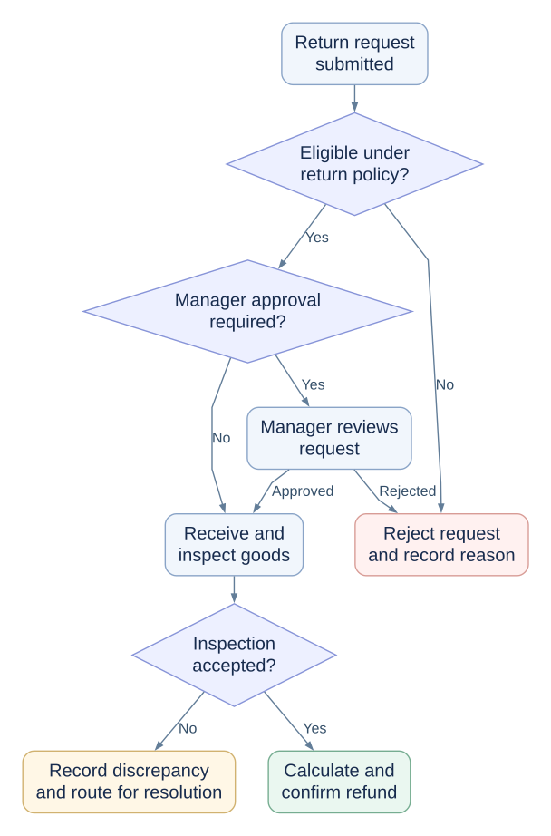
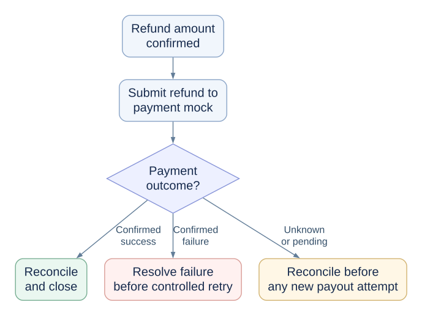

# RetailFlow

### Omnichannel Returns & Refunds · IT Business Analyst Portfolio

A personal business analysis case study exploring how a retail chain could manage product returns and refunds across online and physical stores.

**Owner:** [Anh Kho](https://github.com/KhoaLe-net17) (`KhoaLe-net17`) · Third-year Information Technology student at the University of Economics Ho Chi Minh City (UEH)

**Role:** IT Business Analyst · **Domain:** Retail operations · **Status:** Project planning

[Repository](https://github.com/KhoaLe-net17/retailflow-ba-portfolio) · [Questions and feedback](https://github.com/KhoaLe-net17/retailflow-ba-portfolio/issues)

> **Project context:** RetailFlow is an independent business analysis case study based on a fictional retailer. Business conditions, policies, and data are proposed assumptions until validated. This repository does not represent a client engagement, a production deployment, or measured business results.

## Contents

- [Project overview](#project-overview)
- [Business problem and objectives](#business-problem-and-objectives)
- [Scope](#scope)
- [Stakeholders and responsibilities](#stakeholders-and-responsibilities)
- [Proposed workflow](#proposed-workflow)
- [Business rules and edge cases](#business-rules-and-edge-cases)
- [Worked analysis example](#worked-analysis-example)
- [Analysis deliverables](#analysis-deliverables)
- [Data and integration design](#data-and-integration-design)
- [Repository structure](#repository-structure)
- [Tools and working approach](#tools-and-working-approach)
- [Quality and completion criteria](#quality-and-completion-criteria)
- [Current progress](#current-progress)
- [Author and project integrity](#author-and-project-integrity)

## Project overview

RetailFlow follows the business analysis lifecycle from understanding an operational problem to specifying a solution and planning its acceptance testing.

The scenario involves a fictional retailer operating one online sales channel and three physical stores. Customers may request a return for an online purchase at a store. Customer service, store staff, warehouse staff, managers, and finance need a shared view of each request.

The portfolio will demonstrate how business needs connect to process models, business rules, requirements, interface designs, data models, integration specifications, and acceptance tests.

## Business problem and objectives

### Assumed current situation

Return requests are tracked through email and spreadsheets. Staff manually check purchase information, return eligibility, approval status, and payment outcomes. This creates opportunities for inconsistent decisions, duplicate handling, and difficult reconciliation.

These are scenario assumptions, not findings from an actual retailer. They will guide discovery questions rather than substitute for stakeholder evidence.

| Proposed objective | Candidate measure | How it would be evaluated |
| --- | --- | --- |
| Make processing status visible across teams | Time from request submission to final resolution | Compare timestamped cases using an agreed baseline and reporting period |
| Apply return policies consistently | Proportion of reviewed cases that follow the approved policy | Review representative eligible, ineligible, and exception cases |
| Prevent duplicate or excessive refunds | Duplicate successful payouts and refunded amount per order line | Reconcile requests, refundable balances, and payment references |
| Improve operational traceability | Coverage of required events in the audit trail | Check that required events capture actor, time, action, and outcome |

**Baseline and numeric targets:** not established. Any later simulation results will be labeled as simulation results and will not be presented as production impact.

## Scope

### Initial release

| Capability | Included behavior |
| --- | --- |
| Order lookup | Find a purchase and inspect order lines and previous returns |
| Return submission | Select items, quantities, reasons, and a receiving location |
| Eligibility assessment | Check proposed policy conditions and remaining returnable quantities |
| Approval | Apply an agreed approval matrix and record decisions with reasons |
| Goods inspection | Record received quantities, condition, and inventory disposition |
| Refund calculation | Calculate refunds from the original paid amount and approved allocation rules |
| Refund tracking | Model payment submission, uncertain outcomes, and final confirmation |
| Operational reporting | Identify unresolved cases and refunds requiring reconciliation |
| Access and audit | Specify permissions and record important business actions |

### Boundaries

- One market and one currency: VND.
- Online orders returned at a physical store form the primary analysis scenario.
- Synthetic orders, products, users, and payment responses only.
- External order, inventory, and payment systems are represented by proposed contracts or mocks.
- A working application is an optional later extension; the initial focus is analysis quality.

### Outside the initial release

- Product exchanges, warranty claims, and repair management.
- Cross-border returns, multi-currency settlement, and tax-engine integration.
- Live payment processing and production ERP integration.
- Automated fraud scoring and a complete e-commerce storefront.

## Stakeholders and responsibilities

These are fictional stakeholder roles used for analysis, not actual project participants.

| Stakeholder | Main concern | Input or decision needed |
| --- | --- | --- |
| Customer | Clear eligibility, expected refund, and status | Expectations and usability feedback |
| Customer service agent | Accurate information and fewer handoffs | Intake needs, common questions, and exceptions |
| Store associate | Correct receipt and inspection of returned goods | Store handling steps and inspection evidence |
| Store manager | Consistent approval decisions | Approval rules, escalation, and exceptions |
| Warehouse or inventory staff | Correct stock disposition | Restock, quarantine, or other agreed treatment |
| Finance team | Accurate payouts and reconciliation | Refund calculation and payment outcome handling |
| Product owner or business sponsor | Business value and delivery priorities | Scope, priorities, and acceptance decisions |
| Developer and QA roles | Clear, implementable, testable requirements | Technical feedback and test coverage review |

The portfolio owner performs the analysis. Any role-play, simulated interview, or self-review will be identified as such; it will not be recorded as stakeholder approval.

## Proposed workflow

The high-level workflow is split into return handling and refund processing. A detailed BPMN model with responsibilities, handoffs, and exceptions is a planned deliverable.

### Return handling



[View full-size diagram](diagrams/return-handling.svg) · [Diagram source](diagrams/return-handling.dot)

### Refund processing



[View full-size diagram](diagrams/refund-processing.svg) · [Diagram source](diagrams/refund-processing.dot)

Return handling and payment handling will have separate state models. Receiving an item or approving a return does not by itself mean that a refund has succeeded.

## Business rules and edge cases

The following are proposed analysis topics. Exact policies must be resolved and versioned before requirements are baselined.

| ID | Rule or decision to specify | Important edge case |
| --- | --- | --- |
| BR-001 | Define the return window, its starting event, timezone, and boundary | Request submitted exactly at the cutoff |
| BR-002 | Return quantity must not exceed the remaining eligible quantity | Previous completed returns and concurrent open requests |
| BR-003 | Use an agreed allocation of original discounts and paid amounts | Partial return from an order with an order-level discount |
| BR-004 | Cumulative successful refunds must not exceed the eligible paid balance | Several partial refunds for the same order line |
| BR-005 | Define which cases require additional approval and by whom | Requester attempts to approve their own exception |
| BR-006 | Prevent duplicate payout instructions for the same logical refund | Timeout, repeated submission, or duplicate callback |
| BR-007 | Inventory treatment must follow the inspection outcome | Damaged goods must not be automatically marked sellable |
| BR-008 | Important decisions and state changes must be traceable | Rejection reason, approval actor, and payment reconciliation |

Open policy questions include shipping-fee refunds, excluded product categories, lost receipts, approval thresholds, reservation of quantities during open requests, and handling of failed inspections.

## Worked analysis example

**Scenario:** an order contains two identical items priced at VND 300,000 each. An order-level discount of VND 100,000 is applied. There are no other charges in this example. The customer returns one eligible item.

**Example policy assumption:** distribute the discount equally because the two items have equal prices. The allocated discount is VND 50,000 per item, so the refund for one item is **VND 250,000**. Unequal prices, rounding, tax, and shipping need separate rules.

**User story — US-001**

> As a customer service agent, I want to see the calculated refund for the selected return items so that I can explain the expected amount to the customer.

**Acceptance criteria — illustrative draft**

```gherkin
Scenario: Preview a refund for one eligible item
  Given a paid order contains two identical items priced at VND 300000 each
  And the VND 100000 discount is allocated equally between the items
  And there are no other charges or previous returns
  When the agent selects one eligible item for return
  Then the refund preview shows VND 250000
  And the calculation shows the allocated discount of VND 50000
  And no payout is initiated by viewing the preview
```

The intended traceability chain is:

`Business objective → Requirement → Business rule → User story → Screen/API/data design → UAT scenario`

The example demonstrates the analysis approach. It is not evidence that the workflow or payment controls have been implemented or tested.

## Analysis deliverables

All items below are planned unless the progress section explicitly states otherwise. Paths are target locations and may not exist yet.

| Workstream | Planned artifacts | Target location |
| --- | --- | --- |
| Discovery | Project brief, problem statement, scope, stakeholder map, elicitation plan, evidence and assumption log | `docs/01-discovery/` |
| Process analysis | As-is and To-be BPMN, gap analysis, context diagram, glossary | `docs/02-process-analysis/` |
| Requirements | Business requirements, functional requirements, business rules, use cases, prioritized stories and acceptance criteria | `docs/03-requirements/` |
| Solution design | Wireframes, screen specifications, role-permission matrix, return and refund state models | `docs/04-solution-design/` |
| Data and integration | ERD, data dictionary, SQL examples, API contract, sequence diagrams, measurable non-functional requirements | `docs/05-data-and-integration/` |
| Validation | UAT plan, scenarios, requirements traceability matrix, defect log, execution evidence | `docs/06-uat-and-traceability/` |
| Change and evaluation | Change request, impact analysis, decision log, evaluation plan and retrospective | `docs/07-change-and-evaluation/` |
| Portfolio presentation | Concise case study, artifact highlights, demo script, and CV project summary | `portfolio/` |

## Data and integration design

The conceptual data model will explore orders, order lines, products, return requests, return lines, inspections, refund instructions, payment attempts, users, roles, and audit events.

Planned SQL analyses will answer business questions such as:

- Which return requests remain unresolved, and for how long?
- How much returnable quantity remains after completed and reserved requests?
- Which successful refunds exceed the permitted paid balance?
- Which pending payment attempts require reconciliation?
- Which decisions lack required approval or audit information?

Planned integration specifications will cover order lookup, return submission, inspection results, refund initiation, and payment status updates. They will address validation, authorization, error responses, idempotency, and duplicate or out-of-order events.

No API server, database, or runnable application is provided by this README. Setup instructions will be added when executable artifacts exist.

## Repository structure

Target structure as the project develops:

```text
retailflow-ba-portfolio/
├── README.md
├── docs/
│   ├── 01-discovery/
│   ├── 02-process-analysis/
│   ├── 03-requirements/
│   ├── 04-solution-design/
│   ├── 05-data-and-integration/
│   ├── 06-uat-and-traceability/
│   └── 07-change-and-evaluation/
├── diagrams/
├── prototype/
├── sql/
├── api/
├── portfolio/
└── .github/
    ├── ISSUE_TEMPLATE/
    └── pull_request_template.md
```

## Tools and working approach

| Purpose | Proposed tool |
| --- | --- |
| Documentation and version history | Markdown and Git |
| Backlog and milestones | GitHub Issues, Projects, and Milestones |
| Process and data diagrams | diagrams.net; Mermaid for supported diagrams |
| Wireframes and prototype | Figma |
| Data modeling and queries | PostgreSQL and a SQL client |
| API documentation and exploration | OpenAPI and Postman |

These tools are proposed, not a list of completed integrations. The project does not require paid subscriptions.

Work will be organized into small, reviewable issues. Requirements will receive stable IDs, changes will record their rationale and impact, and commits will describe actual changes. Document status will distinguish drafts, reviewed artifacts, and unresolved decisions.

## Quality and completion criteria

- Business needs, solution assumptions, and stakeholder evidence are distinguishable.
- Requirements have clear actors, conditions, expected outcomes, and acceptance criteria.
- Process diagrams include relevant decisions, responsibilities, and exception paths.
- Screens, rules, data definitions, APIs, and state models agree with each other.
- In-scope requirements are linked to UAT scenarios; untested scenarios remain labeled untested.
- SQL examples include synthetic inputs and verifiable expected results.
- Payment designs address duplicate requests, uncertain outcomes, and reconciliation.
- Non-functional requirements specify a measure and a verification approach.
- Changes identify affected rules, requirements, designs, and tests.
- Portfolio claims match the artifacts and evidence available in the repository.

## Current progress

- [x] Select the project topic and define an initial scenario.
- [x] Prepare the project overview and proposed analysis scope.
- [ ] Complete discovery and resolve initial policy assumptions.
- [ ] Model business processes and document requirements.
- [ ] Design screens, data structures, and integration contracts.
- [ ] Prepare and execute applicable validation exercises.
- [ ] Analyze a change request and finalize the portfolio case study.

The current deliverable is this project introduction and plan. Detailed artifacts, validation results, and deployment links will be added as the work is completed.

## Author and project integrity

**[Anh Kho](https://github.com/KhoaLe-net17)** (`KhoaLe-net17`) — Third-year IT student at UEH, building practical business analysis skills and preparing for IT BA internship opportunities.

Only synthetic data will be published. Real customer records, credentials, employer documents, and confidential information are outside this portfolio's scope.

Feedback on business logic, requirement clarity, and test coverage is welcome through repository issues. Any later external contributions will be acknowledged.

**License:** no license has been selected or granted by this README. A license file will be added if the owner chooses one.
