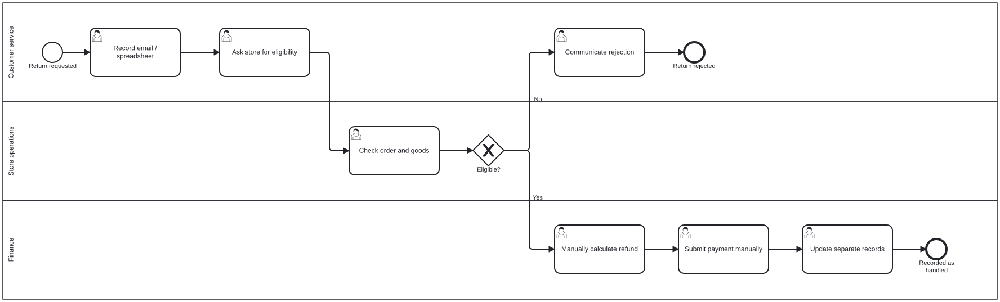
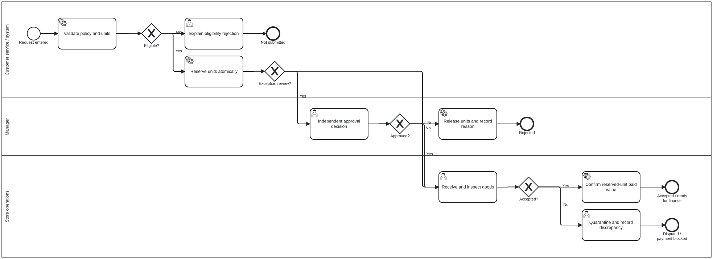
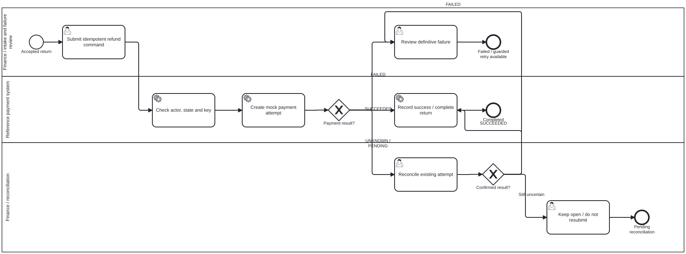

# Process analysis and gap assessment

## Context and handoffs

Customer → CS intake → policy and order information → independent manager review when needed → store inspection → finance/payment reconciliation. Order and payment systems are external concepts; the reference demo uses seeded orders and mock outcomes.

## Current process (assumed)

[Editable BPMN](../../diagrams/as-is.bpmn). CS records email/spreadsheet data, asks store operations to check eligibility and goods, finance manually calculates and submits the refund, then updates separate records. This is a hypothetical current-state model, not observed work.

## Proposed return process

[Editable BPMN](../../diagrams/to-be-returns.bpmn). Check policy and availability, reserve units atomically, route exceptions, inspect goods and confirm original paid value. Rejected eligibility creates no reservation. Independent rejection releases reserved units. Inspection discrepancy retains units and blocks payment.

## Proposed payment process

[Editable BPMN](../../diagrams/to-be-payments.bpmn). Finance submits an idempotent instruction. Success completes the return; definitive failure allows guarded retry. Unknown/pending remains an open reconciliation case on the existing attempt. The model ends with pending work when confirmation is unavailable; it does not imply automatic resolution.

The BPMN sources include lanes and diagram interchange coordinates and render with bpmn-js. These models describe business behavior and are not executable workflow-engine deployments. Pre-inspection cancellation is documented as an alternate flow in the state model; it is not drawn as an interrupting BPMN event.

## Gaps and proposed responses

| Assumed gap | Proposed response | Requirement / evidence |
| --- | --- | --- |
| Repeated cross-team status enquiries | Shared return/payment status and responsible action | FR-011; UAT-33 |
| Inconsistent manual eligibility | Explicit cutoff, exclusions and versioned rules | FR-002; UAT-03–06 |
| Competing requests over same goods | Atomic unit reservations with unique active allocation | FR-003; UAT-31 |
| Partial refund and rounding drift | Original immutable unit paid values | FR-006; UAT-18 |
| Timeout interpreted as failure | Unknown-state reconciliation and retry guard | FR-008/009; UAT-24/29 |
| Decisions difficult to explain | Recorded actor, reason, time and transition | FR-012; UAT-34 |

## Glossary

Return request: request to return purchased goods. Refund instruction: one logical amount owed for accepted units. Payment attempt: one submission under that instruction. Idempotency: repeat a command without repeating its financial effect. Reservation: prevents another request from claiming the same unit. Dispute: inspection discrepancy awaiting a separately designed resolution. Reconciliation: verify an uncertain attempt against authoritative provider evidence. Baseline: versioned selected assumptions, not real stakeholder approval. Net paid: original gross less allocated discount. Terminal outcome: definitive success/failure under the mock provider's semantics. UAT: business-user acceptance testing, not equivalent to automated checks. Audit trail: traceable decisions and state changes.
