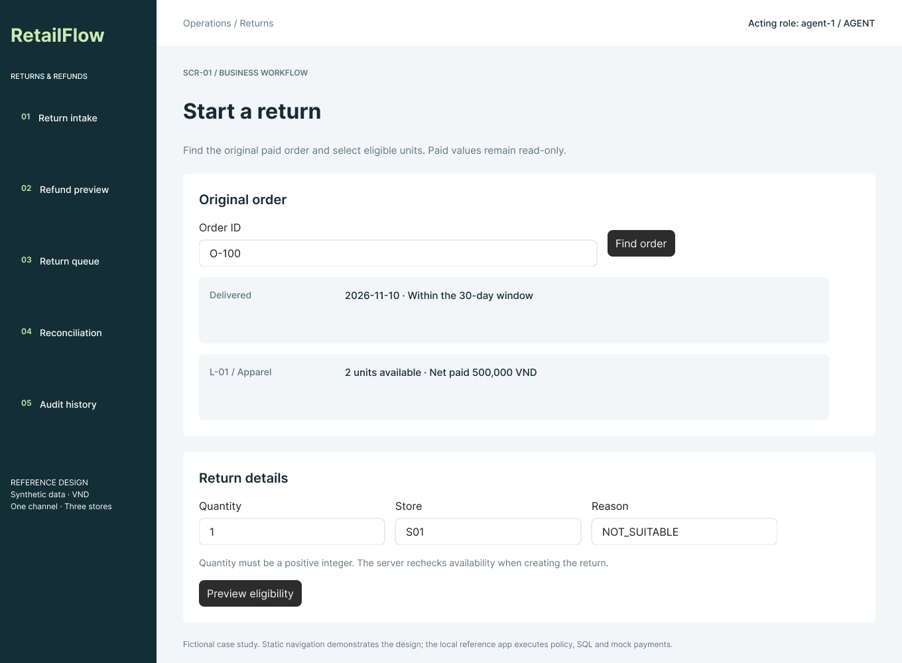

# Figma UX handoff

**Design file:** [RetailFlow · Returns & Refunds](https://www.figma.com/design/7l9l0eDyTbYw2Y6kRguuIp)  
**Owner:** Anh Kho · **Created:** 2026-11-28 · **Scope:** five desktop design frames, static prototype navigation, fictional/synthetic examples.

The file contains native editable text, auto-layout frames, reusable component instances and semantic variables. It was built with the Figma Plugin API through the connected Figma tools. These are source-based interface designs, not generated raster artwork or flattened screenshots. The HTML reference prototype remains the runnable implementation; the Figma version is a handoff view of the workflow, not a pixel-for-pixel copy or a second payment engine.

## Screen map

| Screen | Figma frame | Export | Main requirements / review point |
| --- | --- | --- | --- |
| SCR-01 Intake | [Start a return](https://www.figma.com/design/7l9l0eDyTbYw2Y6kRguuIp?node-id=2-817) | Native file | FR-001/002/003/013; original paid values, integer quantity, store and reason |
| SCR-02 Preview | [Review the refund](https://www.figma.com/design/7l9l0eDyTbYw2Y6kRguuIp?node-id=2-892) | Native file | FR-002/006; 250000 VND example, no mutation until create |
| SCR-03 Queue | [Coordinate the handoff](https://www.figma.com/design/7l9l0eDyTbYw2Y6kRguuIp?node-id=2-941) | Native file | FR-004/005/010/011; O-200/L-02 at 900000 VND; independent manager, separate STORE inspection |
| SCR-04 Reconciliation | [Reconcile before retrying](https://www.figma.com/design/7l9l0eDyTbYw2Y6kRguuIp?node-id=2-1011) | Native file | FR-007/008/009/011; UNKNOWN blocks retry; matched provider fixture |
| SCR-05 Audit | [Explain the decision trail](https://www.figma.com/design/7l9l0eDyTbYw2Y6kRguuIp?node-id=2-1066) | Native file | FR-012; illustrative progression from creation to completion |

This capture records the first composed intake view. The native file subsequently received compact component-height refinements; this image is a documented design snapshot, not a claim to show the latest sizing of every frame.

Use the frame links for canvas review. In Figma, select SCR-01 and use Present to follow navigation. Sidebar links connect the five frames; Preview, Create, Open reconciliation and View audit link the intended review path. There are 24 navigation reactions. Decision/payment buttons other than those navigation links are design affordances, not implemented business actions in Figma. Execute the local app for permissions, data changes and real acceptance evidence.

## Components and tokens

- Imported **Simple Design System** button and input components, with text properties and disabled button variant. Library dependencies retain their own terms.
- Local reusable navigation item, data record and status badge components; screen instances share their source components.
- Primitive colors alias to RetailFlow semantic variables; colors, spacing and radii bind to variables. Product font: Inter. The palette follows the reference UI: deep green navigation, pale canvas, dark text and lime brand accent.
- Desktop frames use auto-layout; labels and supporting copy remain editable. Full-screen image fills are absent. The actual [structure evidence](../../design/figma/manifest.json) records per-screen node counts, font families, component keys and semantic variable IDs.

## Handoff behavior and limits

Apply the [screen/permission specification](screen-specification.md), [SRS](../03-requirements/software-requirements-specification.md) and [state models](state-models.md) when implementing actions. Do not infer that a manager can inspect goods from the combined queue handoff; inspection belongs to STORE. “Simulate matched success” is clearly a provider-event test control, not a real finance integration. Design audit rows are illustrative, not captured runtime evidence.

The [build script](../../design/figma/build-screens.js) preserves the native authoring recipe. It expects Figma's connected `$fig` builder and the Plugin API; it is not a browser script or a standalone `.fig` file. A re-run creates a new composition; edit saved node IDs for revisions instead of blindly re-running it. The native file is the editable design deliverable; access follows Figma sharing settings. SVG export requests returned metadata, but their asset URLs returned HTTP 202 with empty bodies in this environment. No retrieved SVG is claimed or distributed. The connected Starter plan then reached its tool-call limit, so final screenshot review of all five frames and further asset retrieval remain pending. The saved native-structure evidence establishes editable layers, component reuse, Inter fonts and navigation; it does not establish complete visual review. The repository provides the captured intake preview, source recipe and frame IDs without requiring those failed downloads.

This design package has not undergone external usability testing, mobile layout design or business sign-off. Figma navigation does not validate calculations. Validate the reference app separately through its 37 acceptance scenarios and HTTP/SQL checks.
