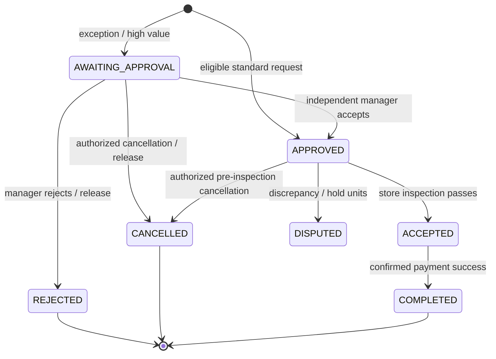
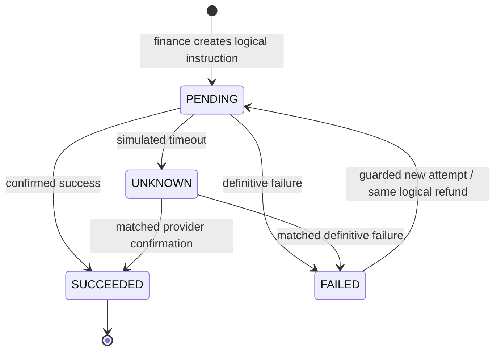

# Return and refund state models

## Return lifecycle

DISPUTED is an unresolved hold, not a successfully completed return. Its resolution is outside the reference slice. Payment FAILED does not reverse accepted goods or release units. Repeated inspection or cancellation after ACCEPTED is denied.

## Logical refund lifecycle

The synchronous mock can report SUCCEEDED/FAILED/UNKNOWN immediately at creation. Retry creates a new attempt; a terminal attempt never transitions again. A late event on an old terminal attempt is recorded as IGNORED_TERMINAL. Exact idempotent replay returns its original response, which can differ from current reconciled status; read workbench for the current status.

## Transition guards

| Command | Allowed state | Actor | Important guard |
| --- | --- | --- | --- |
| Approval | AWAITING_APPROVAL | MANAGER | Different from requester; reason |
| Inspection | APPROVED | STORE | Boolean outcome; reason |
| Cancellation | AWAITING_APPROVAL / APPROVED | Requester or MANAGER | No inspection has occurred |
| First refund | ACCEPTED return | FINANCE | No existing logical refund; valid key |
| Retry | FAILED refund | FINANCE | Definitive failure; new key or exact replay |
| Reconciliation | PENDING / UNKNOWN attempt | PROVIDER fixture | Matching reference; confirmed outcome; deduplicated event |

Any unsupported transition produces a conflict without changing state. See BR-007 through BR-012.
