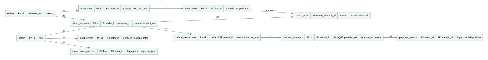

# Data model and dictionary

Canonical executable definitions: [schema](../../sql/00-schema.sql), [synthetic seed](../../sql/01-seed.sql). SQL is PostgreSQL and is executed unchanged by PGlite in the reference checks. Data is in memory and resets on server restart.

| Entity | Business meaning | Keys / important constraints |
| --- | --- | --- |
| actors | Synthetic role fixtures; no passwords or real identities. | id PK; role constrained |
| orders | Original paid purchase and delivery instant. | id PK; delivered_at timestamptz; currency VND |
| order_lines | Original line quantities and gross/discount/net paid integer VND. | id PK; order_id FK; net_paid=gross-discount |
| order_units | Immutable paid-value allocation for each purchased unit. | id PK; line_id FK; unique line/ordinal |
| return_requests | Return ownership, state, receiving store and aggregate amount. | id PK; requester_id FK; order_id FK |
| return_units | Reservation/completion relation between request and purchased unit. | return_id+unit_id PK; unique unit_id WHERE active |
| refund_instructions | One logical refund for accepted units. | id PK; return_id UNIQUE FK; immutable amount_vnd |
| payment_attempts | Each controlled mock provider submission. | id PK; refund_id FK; unique provider_ref; unique refund/attempt_no |
| idempotency_records | Original command response keyed to actor and fingerprint. | key PK; actor_id FK; response_json jsonb |
| payment_events | Deduplicated provider confirmation and applied/ignored outcome. | id PK; attempt_id FK; fingerprint; disposition |
| audit_events | Append-only domain transition records within each session. | id bigserial PK; actor_id FK; detail jsonb; timestamptz |

## Field conventions and invariants

- `*_vnd`: nonnegative integer VND, no floating-point currency. Original line net is gross less allocated discount; unit sums must conserve it. Monetary values in this bounded schema fit PostgreSQL integer range.
- `created_at`, `updated_at`, `delivered_at`: timezone-aware instants. Fixed business clock is explicitly supplied for reproducibility; evidence execution timestamps are actual wall-clock times.
- `status`: separate constrained enumerations for returns and payment. Never infer payment success from return approval or inspection.
- `requester_id`, `actor_id`: foreign keys to synthetic role fixtures. Production user identity and retention are outside the demo.
- `active`: true for reserved and completed return units; false only for rejected/cancelled requests. Unique partial index prevents two active allocations of a unit.
- `reason_code`: stable enum, distinct from explanatory decision/inspection reason in audit details.
- `provider_ref`: attempt-specific mock reference, not a bank transaction receipt.
- `fingerprint`: SHA-256 of canonical operation-specific field sequence; excludes client key and binds the replay to actor. Event fingerprint binds attempt, provider reference and outcome.

## Relationships and deletion

Order → many lines → many units. Return → many reserved units; a unit has at most one active return. Return → at most one logical refund → many attempts → many provider events. Actor → many requests and audit events. No production deletion/retention policy is claimed; session restart resets all data. Never run the seed against a production database.

## Analysis questions

The [six SQL queries](../../sql/02-analysis.sql) calculate remaining units, unresolved age, excessive successful refunds, duplicate successful attempts, allocation mismatches and missing audit fields. [Actual query outputs](../../evidence/sql-results.json) distinguish clean seed from a successful partial return. Zero-row invariant reports mean no violation was found in those fixtures, not proof for all possible inputs.
