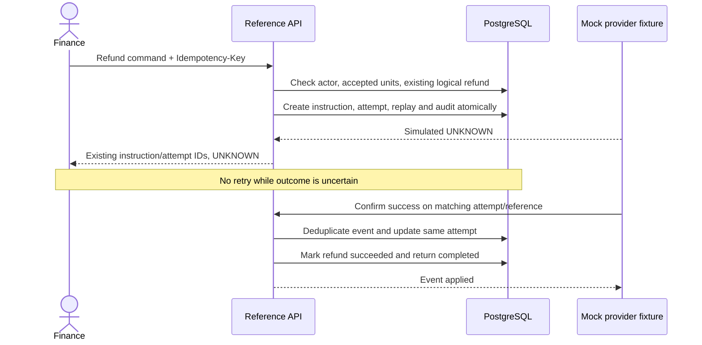

# Integration design and API behavior

## Contract and tools

The [OpenAPI 3.1.1 description](../../api/openapi.yaml) specifies the actual local routes, request/response schemas, role fixture and errors. The [Postman collection](../../api/retailflow.postman_collection.json) contains a seven-step walkthrough; it is supplied for import, not claimed to have been executed in Postman. Actual HTTP response samples and schema validation are separate evidence.

The reference API uses Node's HTTP server and PGlite. Bind is loopback-only. No payment network, customer store, real identity provider or external inventory service is called.

## Sequence: uncertain refund resolved once

The mock outcome is evaluated inside the local transaction; this is not a real distributed payment transaction. In production, persist an outbox/instruction before external delivery, use provider idempotency, verify signed events, reconcile uncertainty, and test recovery after crashes. These are design recommendations, not implemented production capabilities.

## Error and retry policy

400: invalid fields, JSON or key; 401: missing/unknown synthetic actor; 403: role/ownership violation; 404: missing resource; 409: reservation, state, key/event conflict; 413: body over 64 KB; 415: non-JSON request; 422: eligibility/category/line mismatch. Client must re-read after reservation conflict, correct validation input, and never retry a financial command with a new key merely because a response was lost.

## Idempotency and event ordering

Payment and retry commands require an 8–100 character key. Reuse the same actor, operation and semantic fields to replay the original result; reject changes. A distinct key cannot create another logical refund for the same return. PENDING/UNKNOWN only accepts matching reconciliation. FAILED permits a new attempt under the same instruction. Terminal-attempt events are ignored; they do not regress a completed refund. The assumption that failure is definitive is explicit and provider-specific.

## Gaps before any real integration

Verified authentication and row-level permissions, durable storage and keys across restarts, provider signatures, outbox/recovery, rate limiting, monitoring, retention/privacy review, inventory posting, and operational dispute resolution. The prototype is not safe for real financial use.
